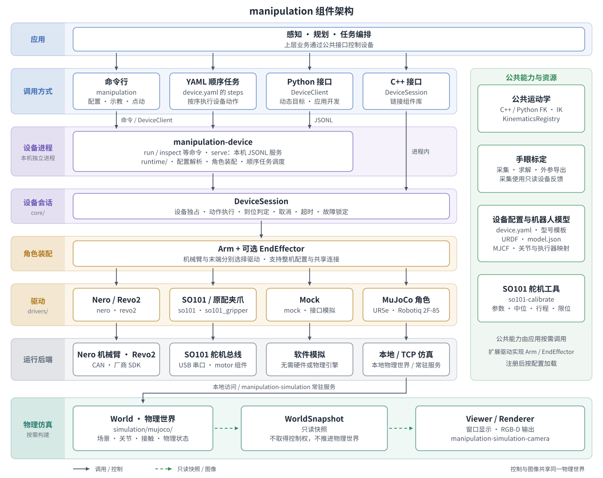

# 机械臂控制组件 manipulation

统一控制机械臂与末端执行器：用设备配置选择硬件，用同一套命令或 C++ / Python 接口下发动作，并提供运动学、手眼标定和设备工具。

| 驱动 | 设备 | 说明 |
| --- | --- | --- |
| `mock_device` | 软件模拟 | 无需硬件 |
| `agx_nero_revo2` | 松灵 Nero 七轴，可选 Revo2 右手 | 点位、连续路径、定时轨迹；Revo2 无位置反馈 |
| `so101` | SO101 五轴，可选原配夹爪 | 点位、使能与失能；夹爪按负载判断是否夹住；附舵机校准工具 |

组件不自动使能、清错、归位或重试。设备独占、到位判定、取消、超时和故障锁定由设备会话统一处理。

## 系统架构



- **调用方**：C++ 应用链接组件库，在进程内使用 `DeviceSession`；命令行和 Python 应用使用 `DeviceClient`，它启动本机进程 `manipulation-device serve` 并经 JSONL 下发请求；YAML 点位任务由 `manipulation-device run` 执行。
- **设备会话**：`core/` 的 `DeviceSession` 统一处理设备独占、到位判定、取消、超时和故障锁定，执行点位、连续路径、定时轨迹、目标跟随和末端执行器动作。
- **驱动**：`runtime/` 经注册表装配设备，可独立选择机械臂与末端驱动，也兼容原有 `device.driver` 配置。驱动负责型号协议和单位转换；同一物理连接由共享连接工厂装配。
- **设备**：Nero 驱动经独立 worker 进程调用厂商 SDK pyAgxArm，SO101 驱动经 `motor` 组件访问舵机总线。
- **能力与工具**：运动学和手眼标定从 `device.yaml` 与 `descriptions/` 取得关节和模型，不写死型号；`so101-calibrate` 直接读写舵机寄存器，用于舵机校准。

## 1. 安装

在 SDK 根目录执行：

```bash
source build/envsetup.sh
bash components/thirdparty/pyagxarm/tools/setup_sdk.sh
cd components/control/manipulation
mm --with-deps
```

- 组件安装到 `output/staging`，缺少系统依赖时按提示安装；新终端须重新执行 `source build/envsetup.sh`。
- 构建选项 `MANIPULATION_ENABLE_NERO`、`MANIPULATION_ENABLE_SO101` 默认开启；检测到 OpenCV 时同时构建标定求解器（`MANIPULATION_ENABLE_CALIBRATION`）。

## 2. 运行 Mock

```bash
manipulation demo
```

执行两轴机械臂和六通道末端执行器的模拟点位任务，不连接硬件。

### 配置组合

`device.arm.driver` 与 `device.effector.driver` 分别选择机械臂和末端；各自的 `options` 保存连接参数。

| 角色 | 已注册驱动 |
| --- | --- |
| 机械臂 | `mock`、`nero`、`so101` |
| 末端执行器 | `mock`、`revo2`、`so101_gripper` |

不同连接分别填写 `resource_id`；共用连接时使用相同标识，且该驱动对须注册共享连接工厂。
Nero / Revo2、SO101 / 原配夹爪已提供共享连接。软件组合不代表机械安装、电气连接或应用动作兼容。

在组件目录运行独立组合示例，无需硬件：

```bash
manipulation drivers --roles
manipulation validate --plan examples/composed_mock.yaml
manipulation capabilities --plan examples/composed_mock.yaml
manipulation run --plan examples/composed_mock.yaml
```

### 顺序任务

`steps` 按注册的能力名称组合动作，开始执行前检查全部步骤。设备不支持的能力会被拒绝。

| 能力 | 用途 |
| --- | --- |
| `joint_point` / `joint_jog` | 关节绝对点位 / 单关节相对运动 |
| `joint_path` / `joint_trajectory` | 连续关节路径 / 定时轨迹 |
| `effector_position` | 末端各通道位置 |
| `arm_hold` / `effector_hold` | 保持并确认停止 |

```bash
manipulation run --plan examples/capability_sequence.yaml
```

该示例使用 Mock。真机的可用能力以 `manipulation capabilities` 的 `registered` 列表为准；配置不能补充驱动缺少的能力。

## 3. 现场目录与当前设备

真机配置保存在现场目录 `SITE`（默认 `~/.local/share/spacemit-manipulation/site/`）。每台设备一个子目录，存放该设备的配置、姿态和校准文件：

```text
SITE/
├── nero/device.yaml
├── so101/device.yaml
├── so101/so101_calibration.json
├── so101/so101_gripper_calibration.json
└── device.yaml -> nero/device.yaml    # 当前设备
```

`configure` 生成配置后，把该设备设为当前设备；其他命令默认控制当前设备，无需重复指定。

```bash
manipulation use          # 列出已配置的设备，* 标记当前设备
manipulation use so101    # 切换当前设备
```

单条命令可用 `--plan FILE` 改用其他配置。

## 4. 连接 Nero

Nero 经支持 SocketCAN 的 USB-CAN 适配器以 1 Mbps 连接主机；Revo2 右手接在机械臂末端口，与机械臂共用连接。
退出厂商 Web、遥操作等其他控制程序后执行：

```bash
sudo ip link set can0 up type can bitrate 1000000
manipulation configure nero --variant revo2_right   # 仅机械臂时去掉 --variant
manipulation inspect
manipulation teach pose_01.json
manipulation hand-move 1 1 0.7 1 1 1
```

- **配置**：保存到 `SITE/nero/device.yaml`，已有文件不覆盖。CAN 接口不是 `can0` 时，追加 `--set channel=<接口名>`。
- **只读命令**：`inspect` 读取状态，`teach` 记录静止姿态，均不运动。
- **灵巧手**：`hand-move` 按 `thumb_tip`、`thumb_base`、`index_finger`、`middle_finger`、`ring_finger`、`pinky_finger` 的顺序给出位置，默认执行 2 s。
  - 位置 `0` 为闭合、`1` 为张开，所有末端执行器相同；
  - Revo2 没有位置反馈，结果为 `unverified`，表示指令已下发并等待执行时间结束，但未测量是否到位；
  - 起始位置未知，即使目标变化很小，手指也可能大幅动作。

机械臂须按厂商规程使能并处于位置模式。现场须有人看护，急停按钮伸手可及。
Nero 失能或断电后会坍塌，不能用失能或断电代替软件停止。

## 5. 连接 SO101

五个关节舵机的 ID 为 1–5，夹爪为 ID 6，共用一个 USB 串口（1 Mbps）。当前用户须属于 `dialout` 组，并退出 LeRobot 等占用串口的程序。

### 校准舵机

SO101 使用通用舵机，首次使用前须校准。已有这台机械臂的 `so101_calibration.json`、`so101_gripper_calibration.json` 时，放入 `SITE/so101/` 即可跳过本节。
新装或重新装配后，先支撑机械臂、取下夹爪中的物品并释放扭矩，再执行：

```bash
so101-calibrate --port /dev/ttyACM0 status    # 只读，每个舵机一行 JSON
so101-calibrate --port /dev/ttyACM0 all       # 按提示完成全部标定
```

`all` 依次执行以下步骤；需要重做某一步时，也可单独执行该步骤：

1. `configure`：写入推荐参数，即 PID 16/0/0、返回延迟 0、位置模式和夹爪扭矩保护。
2. `center`：中位校准，把当前姿态设为编码器中位 2047（模型零位）。
3. `capture`：采集行程，只读，生成两个校准文件。操作方式与 LeRobot 相同：
   - 把前四个关节逐个在整个行程内缓慢转到两端，屏幕实时刷新每个关节的 `MIN`、`POS`（当前位置）和 `MAX`；
   - 全部关节转完后按一次回车；
   - `wrist_roll` 可整圈转动，不采集行程，由配置限位约束；
   - 最后按提示把夹爪分别移到张开和闭合位置。
4. `limits`：把行程写入舵机限位。

校准说明：

- **文件位置**：校准文件保存在 `SITE/so101/`，文件名与 SO101 配置模板一致，`configure` 自动引用。
- **扭矩**：工具从不使能扭矩；除 `status` 外，任一舵机有扭矩时拒绝执行。
- **写入方式**：只写入与当前值不同的寄存器，写入后读回确认。
- **`center` 的影响**：执行后原有校准文件不再匹配，须移走后重新执行 `capture`。
- **部分校准**：`--part arm|gripper` 只处理机械臂或夹爪。

### 配置和控制

```bash
manipulation configure so101 --variant gripper --set port=/dev/ttyACM0   # 仅机械臂时去掉 --variant gripper
manipulation monitor                                 # 只读，持续打印关节角、夹爪位置与负载
manipulation enable && manipulation hand-enable
manipulation joint-step shoulder_pan 0.05 --speed 0.2
manipulation hand-grasp                              # 闭合，报告是否夹住物体
manipulation pose                                    # 当前末端位姿
manipulation pose-move 0.20 0.00 0.15 --speed 0.2   # 末端移到基座坐标 (m)
manipulation line-move 0.20 0.05 0.15 --speed 0.2   # 末端沿直线移动
```

- **监控与示教**：`monitor` 只读；释放扭矩时可手动拖动机械臂观察读数，再用 `teach` 记录姿态。中位姿态下各关节应接近 0°。
- **抓握判断**：
  - 夹爪闭合途中受阻停止，且负载不低于 `grip_load_threshold`（默认为额定输出的 10%）：结果为 `effector_grasp_holding`；
  - 夹爪完全闭合：未夹住物体；
  - 负载判断不是力觉测量，首次抓取新物体时须在旁观察。
- **夹爪使能与保持**：夹爪须先由 `so101-calibrate configure` 设置扭矩保护，否则拒绝使能。夹住物体后执行 `hand-hold` 不会松开。
- **速度与超时**：`--speed 1` 对应 `max_velocity_rad_s`（默认 1 rad/s）。`pose-move` 估算的时长超过 `timeout_s` 时，在运动前拒绝。
- **逆运动学**：五轴机械臂默认只求解位置，加 `--rpy R P Y` 时同时求解姿态。不收敛时不运动；只检查关节限位，不检查碰撞。
- **直线运动**：`line-move` 按 5 mm 间隔逐点求解，任一路点不可达时拒绝整条路径。SO101 不支持连续路径和定时轨迹。

## 6. 手眼标定

采用眼在手外方式：相机固定，ChArUco 标定板安装在法兰上，结果 `T_base_camera` 把相机坐标换算到机械臂基座坐标。

- 需要 OpenCV：执行 `sudo apt install libopencv-dev python3-opencv` 后重新执行 `mm`；
- 需要与 Python 版本匹配的 `pyrealsense2`。

`board.json` 按实物填写标定板参数，例如：

```json
{"type": "charuco", "dictionary": "4x4_50", "squares_x": 5, "squares_y": 7,
 "square_length_m": 0.025, "marker_length_m": 0.018}
```

完成设备配置并准备 `board.json` 后执行：

```bash
hand-eye configure collection.json --installation-id workcell-01 --board board.json
hand-eye collect cal_01 --config collection.json
hand-eye solve cal_01
hand-eye promote cal_01
hand-eye export cal_01
```

- `configure` 引用当前设备及其关节模型；多台相机时追加 `--serial <序列号>`。配置中的路径相对 `collection.json` 解析。
- 采集工具不移动机械臂。按设备规程摆好姿态并静止后输入 `CAPTURE`；默认采集 12 组。
- 求解使用全部样本和留出样本评估，残差阈值默认 5 mm / 2°。未通过时不能发布结果。
- 数据与结果保存在 `SITE/cal_01/`；`export` 生成 `extrinsic.json`，不覆盖已有文件。

采集、求解与评估不依赖应用。相同流程可用于 Dice Arena 和 `perceptive_grasp`；后者的外参配置片段由以下命令生成：

```bash
hand-eye export-perceptive cal_01 --installation-id workcell-01 --output perceptive_calibration.yaml
```

把生成的 `calibration.realsense.T_base_camera` 合入抓取配置。它只更新外参，不迁移抓取控制路径。
`workcell-01` 标识固定的机械臂、相机安装；更换基座、相机位置或安装后须重新标定，不能仅沿用标识复用旧结果。

## 7. 在程序中使用

**Python**（`source build/envsetup.sh` 后可直接导入）：

```python
from spacemit_manipulation import DeviceClient

with DeviceClient("manipulation-device", "examples/mock_device.yaml") as arm:
    print(arm.state())
    arm.move_arm([0.2, -0.2], speed_scale=0.05)
    arm.move_effector([0.5] * 6, duration_s=0.5)
    arm.execute_capability("joint_jog", {"joint_index": 0, "delta_rad": 0.1})
```

- **失败处理**：运动失败时抛出 `DeviceCommandError`，`result` 字段包含结果状态；`rejected` 表示请求未写入设备，`latched` 表示会话已锁定。
- **目标跟随**：遥操作、视觉伺服等需要高频更新目标的场景使用 `follow_arm()` / `follow_effector()`，发出目标即返回；结束时调用 `hold_arm()` 或 `move_arm()`。
- **无反馈末端执行器**：结果为 `unverified`，须传入 `allow_unverified=True` 才接受。

**运动学**（不访问设备，需要 `numpy`；`PREFIX` 由 `source build/envsetup.sh` 设置）：

```python
import json, os
from pathlib import Path
from spacemit_manipulation import urdf_ik
from spacemit_manipulation.urdf_fk import UrdfKinematics

root = Path(os.environ["PREFIX"]) / "share/manipulation/descriptions/robots/so101"
config = json.loads((root / "model.json").read_text())
model = UrdfKinematics(root / config["urdf"], config["base"], config["tip"], config["joints"])
result = urdf_ik.solve(model, urdf_ik.pose([0.2, 0.0, 0.15]), seed_rad=[0.0] * 5)
print(result["converged"], result["joints_rad"])   # 收敛后交给 DeviceClient.move_arm
```

**C++**：

```cmake
find_package(manipulation CONFIG REQUIRED)
target_link_libraries(app PRIVATE spacemit::manipulation_motion spacemit::manipulation_drivers)
```

```cpp
#include "manipulation/device_plan.h"
namespace m = spacemit::manipulation;

auto registry = m::MakeBuiltinDeviceRegistry();
auto plan = m::LoadDevicePlan("examples/mock_device.yaml", registry);
m::DeviceSession session(plan.definition, m::CreatePlanDevices(plan, registry));
session.Connect();                                    // 获取设备独占，不使能、不运动
auto result = session.MoveArm({{0.2, -0.2}, 0.05});   // 阻塞至到位、失败或取消
```

**YAML 顺序任务**：在设备配置的 `steps` 中按顺序写入动作，用 `manipulation run --plan FILE` 执行。复杂判断、重试与恢复保留在应用中。

## 8. 新增驱动

1. 实现 `Arm` 或 `EndEffector`，用 `RegisterArm` 或 `RegisterEffector` 注册；共用连接的组合另用 `RegisterShared` 注册。参考 `examples/bench_driver/bench_driver.cpp`。
2. 在模块的 `CMakeLists.txt` 中登记：
   ```cmake
   target_sources(manipulation_drivers PRIVATE ${CMAKE_CURRENT_SOURCE_DIR}/my_driver.cpp)
   manipulation_register_device(RegisterMyDevice)
   ```
3. 构建时用 `MANIPULATION_EXTRA_DRIVER_DIRS` 指定模块目录。
4. 在 `descriptions/robots/<型号>/devices/` 放置配置模板，供 `manipulation configure` 使用。

无需修改公共头文件或已有驱动。驱动约定见[开发指南](docs/development.md)。

新增顺序能力时，在模块中注册参数解析、支持条件、参数校验和执行函数，使用 `manipulation_register_capability` 纳入构建。
示例位于 `examples/capability_probe/`；无需修改任务解析器或执行分支。

## 9. 使用限制

- **抓稳判断**：位置到位不代表物体已抓稳。声明 `grasp_detection` 的末端执行器按负载判断是否夹住，这不是力觉或触觉测量。
- **软件停止**：Ctrl+C 请求软件保持，不是急停；现场以急停按钮为准。
- **设备独占**：只约束本机使用同一锁机制的程序，不约束厂商 Web 或其他主机。
- **无反馈末端执行器**：开环执行；取消或中断后结果为 `stop_unknown`，须现场检查后重新连接。
- **碰撞检测**：不提供；`pose-move`、`line-move` 只检查关节限位。
- **机械臂数量**：只支持单臂。

## 目录结构

```text
manipulation/
├── include/manipulation/   # C++ 公共接口
├── core/                   # 设备会话：独占、执行、到位判定、故障处理
├── runtime/                # 配置解析、设备装配与 YAML 顺序任务
├── drivers/                # 设备驱动
│   ├── arms/               # 机械臂驱动
│   │   ├── nero/           # Nero 七轴机械臂
│   │   └── so101/          # SO101 五轴机械臂
│   ├── effectors/          # 末端执行器驱动
│   │   ├── revo2/          # Revo2 灵巧手
│   │   └── so101_gripper/  # SO101 原配夹爪
│   ├── common/             # 共享连接
│   │   ├── agx_session/    # Nero 与 Revo2 共享会话
│   │   └── so101_session/  # SO101 机械臂与夹爪共享串口总线
│   └── mock/               # 无硬件模拟设备
├── capabilities/           # 公共能力与命令行工具
│   ├── motion/             # 运动控制与 manipulation-device
│   ├── diagnostics/        # 设备检查与 manipulation 操作命令
│   ├── kinematics/         # 正逆运动学
│   └── calibration/        # 姿态采集与手眼标定
├── bindings/python/        # Python 客户端 DeviceClient
├── descriptions/robots/    # 机型描述：URDF、model.json、配置模板
├── examples/               # Mock 配置、C++ 接入、驱动与能力扩展
├── tools/                  # 辅助脚本
├── tests/                  # 测试
└── docs/                   # 接口参考与开发指南
```

## 参考文档

- [接口参考](docs/reference.md)：配置字段、命令参数、返回值和 API。
- [开发指南](docs/development.md)：驱动约定、能力与工具扩展、测试。
- SDK 应用 `application/native/dice_arena`：基于本组件的视觉抓杯与摇骰子游戏。

## License

本组件源码文件头声明为 Apache-2.0，最终以本目录 `LICENSE` 文件为准。第三方声明和衍生作品见 `NOTICE`。
